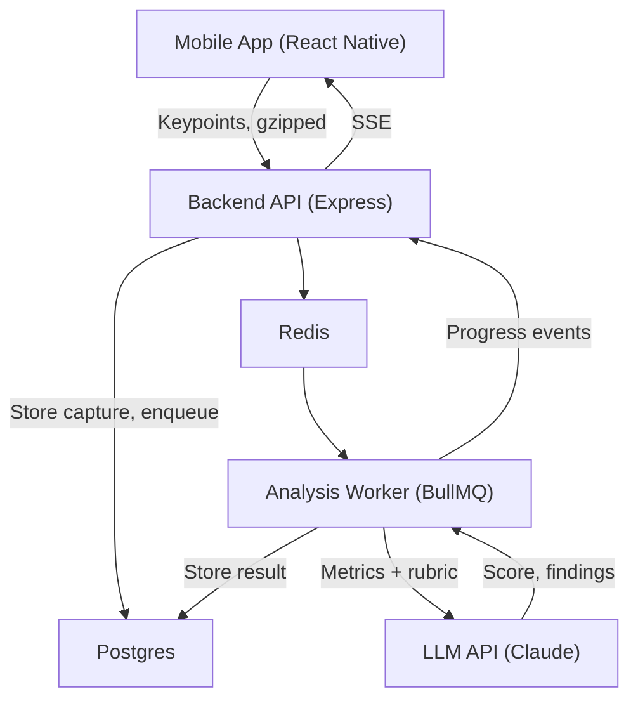

# CaliAI – System Architecture

---

# 1. High-Level Overview

CaliAI is a Turborepo monorepo with three runtime pieces:

- Mobile client (React Native / Expo custom dev build)
- Backend API and analysis worker (Node.js / Express 5)
- Database (Postgres) and Redis (job queue)

Pose estimation runs **on the phone**. Video never leaves the device; the server
receives body keypoints and turns them into feedback. There is no separate AI
microservice.

---

# 2. System Components

## 2.1 Mobile Application

- Camera capture with `react-native-vision-camera`
- A frame processor runs MediaPipe PoseLandmarker (33 keypoints, GPU delegate,
  about 30 fps) through `react-native-mediapipe-posedetection`; see
  `.planning/phases/05-ai-form-analysis-camera-post-set/05-POSE-RUNTIME-DECISION.md`
- Keypoints are buffered with timestamps; no video file is recorded
- A setup check (framing guide, trackability, light) gates the Start button
- Sends the keypoints to the API when the set ends, then listens for progress
  and results over SSE; an in-app banner announces the result
- Asks for, and records, consent to send profile data and pose measurements
  to the LLM provider

Requires a custom Expo dev build (`expo-dev-client`); it does not run in Expo Go.

## 2.2 Backend API

Three tiers: route → controller → service → Prisma.

- Authentication, sessions, workouts, profile
- `POST /api/sessions/:id/capture`: validates and stores the keypoints,
  enqueues an analysis job, returns 202 with a job ID
- `GET /api/sessions/:id/status`: SSE stream of job progress

## 2.3 Analysis Worker

A BullMQ worker. For each job it:

1. Decodes the stored keypoints (gzip-json-v1)
2. Runs `computeFormMetrics` (pure TypeScript in `apps/api/src/metrics/`):
   preprocess, trackability, rep segmentation, rubric evaluation, scoring and
   finding selection
3. If the set is `UNTRACKABLE`, short-circuits: no LLM call, the result holds
   camera advice
4. Otherwise asks the LLM to phrase the server-selected findings, with an
   `AbortSignal` deadline so a timed-out call is cancelled
5. Persists the result with a guarded, idempotent write (a late or duplicate
   run cannot overwrite a finished one)
6. Completes the run and emits the completion event

**Score and band are deterministic; the LLM never scores.** The rubric decides
the dimension results, the 0-100 score and the band, and chooses which
findings are reported. The LLM only writes the wording of those findings. The
raw score is stored for trends and is never returned by the API.

Versions stored with every result: `metrics-v1` (metrics pipeline),
`rubric-v1` (calibrated thresholds, see `05-RUBRICS.md` and
`05-CALIBRATION.md`) and `form-feedback-v1` (prompt), plus the LLM model.

## 2.4 Database (Postgres)

Stores users, exercises, workout sessions, pose captures, analysis results,
findings, form labels and training consent. See `data-model.md`.

## 2.5 Object Storage (Cloudflare R2)

Used for user avatars only. No video or frames are stored.

---

# 3. Request Flow – Form Analysis

1. User picks an exercise and is offered the option to record the set. If they
   decline, the set is logged without analysis and nothing below runs.
2. If they accept, the camera opens. The phone runs pose estimation on live
   frames and buffers keypoints.
3. The set ends. The phone compresses the keypoints and calls
   `POST /api/sessions/:id/capture`.
4. The API validates (Zod), stores a `PoseCapture`, sets the session to
   `PROCESSING`, enqueues the job and returns 202.
5. The phone subscribes to the SSE status stream.
6. The worker analyzes the capture and stores the result.
7. The session becomes `COMPLETED` (or `FAILED`); the phone receives the event
   and shows the feedback.

Sessions stuck in `PROCESSING` for more than 3 minutes are failed
automatically.

---

# 4. Feedback Quality

- The LLM never receives raw coordinates, only the server-selected findings
  with their measured values, the exercise and the user's height and weight as
  context. It does not score.
- Output is structured and validated: up to 2 corrections, positives first.
- Every result records the LLM model, prompt version, rubric version and
  metrics version so results can be compared and recomputed.
- Per-exercise definitions (keypoints used, metrics, target ranges, error tags,
  rubric) are data in `@repo/common`, so adding an exercise is configuration,
  not a new pipeline.

---

# 5. Training Data and Own Model

The rubric (deterministic metrics) is the scorer at launch; the LLM only writes the coaching text. Meanwhile:

- Consented sets keep their raw keypoints. Non-consented sets keep only the
  result.
- Planned (not built in Phase 5): each result also creates a `FormLabel` (source `RUBRIC`/`LLM`, score bucket, error
  tags, versions). Other label sources (`SELF_REVIEW`, `USER_RATING`,
  `OWN_MODEL`) can be added for the same capture.
- The owner spot-checks a sample of sets by watching skeleton replays.
- A model trained on these labels can only match the rubric and LLM, so the goal is to
  cut cost, not to improve quality. The LLM keeps writing the coaching text.
- Training splits by user. The new model first runs in shadow mode, unseen by
  users, before it replaces the LLM score.

---

# 6. Turborepo Structure

- `apps/api` – Express API and worker
- `apps/native` – Expo app
- `packages/database` – Prisma schema and client
- `packages/common` – Zod schemas, analysis functions, exercise definitions
- `packages/ui` – component library

---

# 6a. AI Workout Generation

- Synchronous `POST /api/workouts/generate` (no queue); returns a draft plan the client previews, then saves through the normal workout endpoint.
- Shared gate `aiPrerequisitesService.assertAiPrerequisites` checks profile completeness, AI consent and catalog; Phase 5 reuses it.
- `LlmProvider` interface with `AnthropicProvider`: structured outputs, a per-request exercise-code enum (no exercise outside the catalog), `maxRetries: 0`, `AbortSignal` for timeouts (no `withTimeout`).
- Attempt ladder: Haiku, then Haiku with validation feedback, then Sonnet.
- Errors: 428 `PROFILE_INCOMPLETE`, 429 `DAILY_LIMIT_REACHED`, 409 `GENERATION_IN_PROGRESS`, 503 `GENERATION_FAILED` / `CATALOG_EMPTY`.
- Daily cap via `AI_GENERATION_DAILY_CAP` (rolling 24h, counts all `workout_generations` rows).
- Provenance: saved plans carry `ai_model` and `generation_id`.
- Deploy: run `yarn workspace @repo/db db:seed` after `db:migrate:deploy` so the `dip` exercise exists.

---

# 7. Architecture Principles

- Pose runs where the video is, so video stays on the device.
- Deterministic code measures; the LLM explains.
- Store the least data that serves the purpose; ask before keeping more.
- Version everything that affects a result (pose model, metrics, rubric,
  prompt, LLM).
- Exercises are data, not code.

---

# 8. Open Decisions

- Pricing model and the cost cap per analysis
- Retention period and sampling of consented sets
- Consent wording, minimum age and legal review
