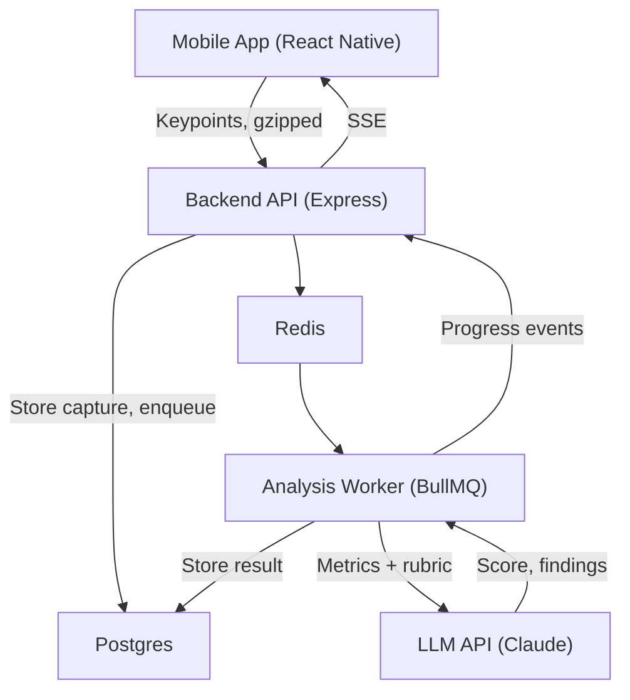

# CaliAI – System Architecture

---

# 1. High-Level Overview

CaliAI is a Turborepo monorepo with three runtime pieces:

- Mobile client (React Native / Expo custom dev build)
- Backend API and analysis worker (Node.js / Express 5)
- Database (Postgres) and Redis (job queue)

Pose estimation runs **on the phone**. Video never leaves the device; the server
receives body keypoints and turns them into feedback. There is no separate AI
microservice.

---

# 2. System Components

## 2.1 Mobile Application

- Camera capture with `react-native-vision-camera`
- A frame processor runs the pose model on each frame via
  `react-native-fast-tflite` (MoveNet)
- Keypoints are buffered with timestamps; no video file is recorded
- A quality gate checks framing and keypoint confidence before the set starts
- Sends the keypoints to the API when the set ends, then listens for progress
  and results over SSE
- Asks for, and records, consent to use data for model training

Requires a custom Expo dev build (`expo-dev-client`); it does not run in Expo Go.

## 2.2 Backend API

Three tiers: route → controller → service → Prisma.

- Authentication, sessions, workouts, profile
- `POST /api/sessions/:id/capture`: validates and stores the keypoints,
  enqueues an analysis job, returns 202 with a job ID
- `GET /api/sessions/:id/status`: SSE stream of job progress

## 2.3 Analysis Worker

A BullMQ worker. For each job it:

1. Loads the stored keypoints
2. Smooths them, drops low-confidence frames, and splits them into reps
3. Computes per-rep metrics (angles, range, symmetry, tempo, body line) with
   pure TypeScript shared via `@repo/common`
4. Sends metrics, the exercise rubric and user context to the LLM
5. Validates the structured result (at most 2 corrections, positive first)
6. Stores the result and a label, deletes the keypoints if the user has not
   consented to training use, and emits the completion event

If keypoint confidence is too low, it returns camera advice instead of
calling the LLM.

## 2.4 Database (Postgres)

Stores users, exercises, workout sessions, pose captures, analysis results,
findings, form labels and training consent. See `data-model.md`.

## 2.5 Object Storage (Cloudflare R2)

Used for user avatars only. No video or frames are stored.

---

# 3. Request Flow – Form Analysis

1. User picks an exercise and is offered the option to record the set. If they
   decline, the set is logged without analysis and nothing below runs.
2. If they accept, the camera opens. The phone runs pose estimation on live
   frames and buffers keypoints.
3. The set ends. The phone compresses the keypoints and calls
   `POST /api/sessions/:id/capture`.
4. The API validates (Zod), stores a `PoseCapture`, sets the session to
   `PROCESSING`, enqueues the job and returns 202.
5. The phone subscribes to the SSE status stream.
6. The worker analyzes the capture and stores the result.
7. The session becomes `COMPLETED` (or `FAILED`); the phone receives the event
   and shows the feedback.

Sessions stuck in `PROCESSING` for more than 10 minutes are failed
automatically.

---

# 4. Feedback Quality

- The LLM never receives raw coordinates, only per-rep metrics, target ranges,
  the exercise rubric and a summary of the user's recent sessions.
- Output is structured and validated: score, up to 2 corrections, at least one
  positive observation where deserved.
- Every result records the LLM model, prompt version, rubric version and
  metrics version so results can be compared and recomputed.
- Per-exercise definitions (keypoints used, metrics, target ranges, error tags,
  rubric) are data in `@repo/common`, so adding an exercise is configuration,
  not a new pipeline.

---

# 5. Training Data and Own Model

The LLM is the scorer at launch. Meanwhile:

- Consented sets keep their raw keypoints. Non-consented sets keep only the
  result.
- Each result also creates a `FormLabel` (source `LLM`, score bucket, error
  tags, versions). Other label sources (`SELF_REVIEW`, `USER_RATING`,
  `OWN_MODEL`) can be added for the same capture.
- The owner spot-checks a sample of sets by watching skeleton replays.
- A model trained on these labels can only match the LLM, so the goal is to
  cut cost, not to improve quality. The LLM keeps writing the coaching text.
- Training splits by user. The new model first runs in shadow mode, unseen by
  users, before it replaces the LLM score.

---

# 6. Turborepo Structure

- `apps/api` – Express API and worker
- `apps/native` – Expo app
- `packages/database` – Prisma schema and client
- `packages/common` – Zod schemas, analysis functions, exercise definitions
- `packages/ui` – component library

---

# 7. Architecture Principles

- Pose runs where the video is, so video stays on the device.
- Deterministic code measures; the LLM explains.
- Store the least data that serves the purpose; ask before keeping more.
- Version everything that affects a result (pose model, metrics, rubric,
  prompt, LLM).
- Exercises are data, not code.

---

# 8. Open Decisions

- Pricing model and the cost cap per analysis
- Pose model: MoveNet versus a 33-point model for inverted and horizontal
  skills (decided by an accuracy check)
- Keypoint payload format (gzip JSON versus quantized binary)
- Retention period and sampling of consented sets
- Consent wording, minimum age and legal review
